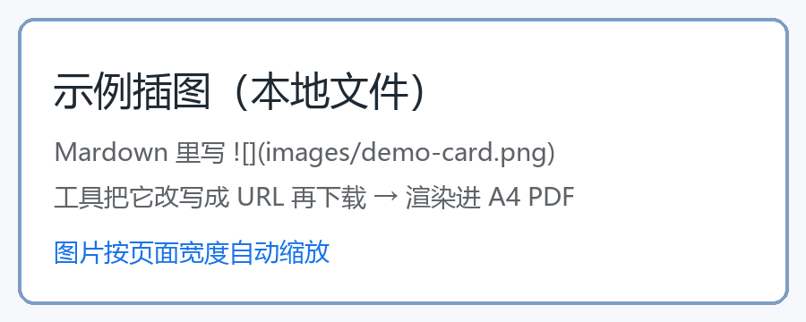

# 示例：Markdown 里的图片是本地文件

下面这张图写在 Markdown 里是**相对路径**：``。

在线转换服务读不到它（它在人家服务器上渲染，只能去下载 URL），
本工具的做法是：先把相对路径改写成 URL——默认指向一个本机内置的静态服务，
也可以 `--base-url` 指向仓库的 raw 地址——然后**用 HTTP 下载**，再渲染成 A4 PDF。



## 表格也照常

| 项 | 值 | 说明 |
|---|---|---|
| 纸张 | A4 | 210 × 297 mm |
| 分页 | 自动 | 按页面长度分页，标题不会落在页尾 |
| 图片 | 按页宽缩放 | 超过页宽自动缩小 |

## 代码块

```python
print("中文、表格、代码、图片都保留")
```

> 引用块：说明性文字放这里。
